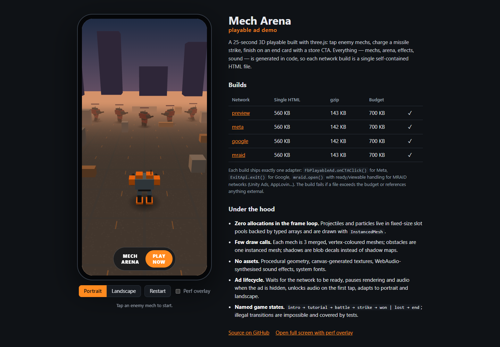

<h1 align="center">Mech Arena — playable ad</h1>

<p align="center">
  A 3D playable ad on three.js: one self-contained HTML file per ad network, with size and frame budgets checked on every build.
</p>

<p align="center">
  <a href="https://s-afanasiev.github.io/mech-arena-playable/"><b>Live demo</b></a>
  &nbsp;·&nbsp;
  <a href="https://s-afanasiev.github.io/mech-arena-playable/play/preview/index.html?debug"><b>Full screen + perf overlay</b></a>
  <br>
  <a href="https://github.com/s-afanasiev/mech-arena-playable/actions/workflows/pages.yml"></a>
</p>



## Gameplay (≈20 s)

Intro fly-in → a hand points at an enemy mech: **tap to attack** → your mech turns and fires while the enemy squad advances and shoots back → after 3 kills a **missile strike** button charges up → victory or defeat → end card where the whole screen is the store CTA. An idle player gets a hint after 2.5 s; the battle times out at 30 s.

## What the build guarantees

| | |
|---|---|
| **Single HTML** | Script and styles are inlined; the build fails on any external `src`/`href`. ~560 KB raw, ~143 KB gzip — budget 700 KB. |
| **Network adapters** | One adapter per build, chosen at build time: Meta `FbPlayableAd.onCTAClick()`, Google `ExitApi.exit()`, MRAID `mraid.open()` with `ready` / `viewableChange` handling (Unity Ads, AppLovin…), and a preview build for the browser. |
| **Ad lifecycle** | Starts after the network is ready, pauses rendering and audio while the ad is hidden, unlocks audio on the first tap, adapts to portrait and landscape and to notches (`safe-area-inset`). |
| **Frame budget** | ≤ 60 draw calls and ≤ 60 k triangles; the `?debug` overlay shows FPS, worst frame, draw calls, triangles, GPU objects, pool usage and JS heap, and highlights anything over budget. |

Measured in desktop Chrome with phone emulation: 60 FPS, at most 46 draw calls, ~6.6–8.8 k triangles, JS heap 7–17 MB over a full round. On a real phone open the `?debug` link via Chrome remote debugging (Android) or Safari Web Inspector (iOS).

## How it stays small and fast

- **No assets at all.** Mechs and arena are built from primitives; ground and blob shadows are canvas-generated textures; sound effects are synthesised with WebAudio; fonts are system fonts.
- **Zero allocations in the frame loop.** Projectiles and particles live in fixed-size slot pools backed by typed arrays and render through `InstancedMesh`; temporary vectors are module-level and reused.
- **Few draw calls.** Each mech is three merged, vertex-coloured meshes (body + two legs) sharing one material; all obstacles are one instanced mesh; the skyline is another.
- **Cheap lighting.** Hemisphere + one directional light, fog, blob shadows instead of shadow maps; explosions use unlit particles and a CSS flash instead of dynamic lights (adding a light recompiles shaders).
- **Capped pixel ratio** (`min(devicePixelRatio, 2)`), frame time clamped after pauses, rendering stops completely when the ad is hidden.

## Architecture

```
main.js                     assembly point: what the ad is made of, nothing else
  networks/<name>.js        adapter contract: ready() · onVisibility(fn) · openStore() · gameEnd()
  core/flow.js              game states: intro → tutorial → battle → strike → won | lost → end
  core/slot-pool.js         fixed-capacity pool, idempotent release
  game/battle.js            per-frame orchestration; turns facts (hit, kill, timeout) into effects
  scene/                    view, arena, mech builder, player, enemy squad, projectiles, particles, camera rig
  ui/                       HUD, tutorial hand, strike button, end card, debug overlay (plain DOM)
  audio/sfx.js              WebAudio synth
scripts/build.mjs           vite build per network → inline into one HTML → budget and external-reference checks
showcase/                   the demo page around the preview build
```

The game flow is a transition table: a missile strike before three kills or a win after a loss cannot happen, and tests cover it.

## Run

```bash
npm install
npm run dev     # http://127.0.0.1:5174 — preview build with hot reload
npm test        # flow and pool tests
npm run build   # dist/play/<network>/index.html for every network + dist/index.html showcase
```

Before a real campaign each file still goes through the network's own playable validator or preview tool; the store URL in `src/config.js` is a placeholder.

---

<sub>A personal demo inspired by mech shooters; not affiliated with any game or publisher.</sub>
